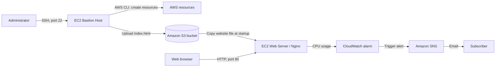

# AWS Static Website Hosting and Monitoring

In this project, I built a static website using AWS services. I used two EC2 instances, Amazon S3, Nginx, and the AWS CLI to set up the website. I also added CPU monitoring with CloudWatch and email alerts using Amazon SNS.

> **Project status:** Completed in May 2026 as part of an AWS Learner Lab course. This is a learning project, not a production website or a currently running service.

## Architecture

I used two EC2 instances in the default VPC and subnet of the lab environment. The first instance was a **bastion host**, which I used to manage AWS resources through SSH and the AWS CLI. The second instance was a **web server** running Nginx.

The HTML file was stored in an S3 bucket and copied to the web server during setup. **The website was hosted by Nginx on EC2, not directly by S3.**

## Technologies used

- **AWS:** EC2, S3, IAM instance profile (`LabInstanceProfile`), VPC security groups, CloudWatch, SNS
- **Operating system and web server:** Amazon Linux 2023, Nginx
- **Tools:** AWS CLI, SSH/PuTTY, Bash, EC2 user data
- **AWS Region:** `us-east-1`

## What I did

### Phase 1 — Set up the website

1. I found the default VPC and created separate security groups for the two EC2 instances.
2. I launched a bastion host and connected to it using SSH.
3. I created an S3 bucket and uploaded an `index.html` file using the AWS CLI.
4. I launched a web server with a user data script. The script installed Nginx and AWS CLI, copied the HTML file from S3 to `/usr/share/nginx/html`, and started Nginx.
5. I opened the web server's public IP address in a browser and confirmed that the website worked.

### Phase 2 — Add monitoring

1. I created an SNS topic and subscribed to email notifications.
2. I created a CloudWatch alarm to monitor the web server's CPU usage. The alarm was set to trigger when the average CPU usage was **above 70% for two consecutive one-minute periods**.
3. I generated temporary CPU load to test the alarm. It changed to `ALARM`, and I received an email notification.
4. I stopped the CPU load and checked that the alarm returned to `OK`.

## How I tested the project

I checked each part of the setup:

- I connected to the bastion host with SSH.
- I confirmed that the HTML file was stored in S3.
- I opened the website in a browser and checked that Nginx displayed the page.
- I tested the CloudWatch alarm by increasing CPU usage and checking the email notification.
- I confirmed that the alarm returned to `OK` after the test.

My original report includes screenshots of these steps. I have **not uploaded the original PDF** because one screenshot contains AWS access credentials and session information. I may add screenshots with sensitive details removed later.

## Security notes

This project was made in a learning environment. I would make several changes before using a similar setup in production:

- **SSH access:** During the lab, port 22 was open to `0.0.0.0/0`. In a real environment, I would limit SSH access or use AWS Systems Manager Session Manager.
- **HTTPS:** The website used HTTP on port 80. A public website should use HTTPS.
- **Network design:** Both EC2 instances used the default subnet. A more secure design could use separate public and private subnets and a load balancer.
- **IAM permissions:** I used the lab's existing IAM instance profile. In a real environment, I would give each instance only the permissions it needs.
- **Secrets:** AWS credentials, session tokens, and private keys should never be uploaded to GitHub.

## What I learned

This project helped me understand how AWS services work together. I gained practical experience with:

- Creating and managing EC2 instances using the AWS CLI
- Setting up security groups and IAM instance profiles
- Storing website files in S3
- Installing and starting Nginx automatically with a user data script
- Monitoring an EC2 instance with CloudWatch
- Sending email alerts with SNS
- Testing and troubleshooting an AWS environment

## What I would improve next

These are ideas for future work, **not features I have already implemented**:

- Move the web server to a private subnet and use a public load balancer
- Add HTTPS and improve security group rules
- Use Terraform or CloudFormation to create the infrastructure
- Add more monitoring and logging

## Repository files

- [`docs/implementation.md`](docs/implementation.md) — More detailed notes about the setup and testing
- [`scripts/nginxinstall.sh`](scripts/nginxinstall.sh) — An example user data script based on the lab setup, with sensitive information removed
