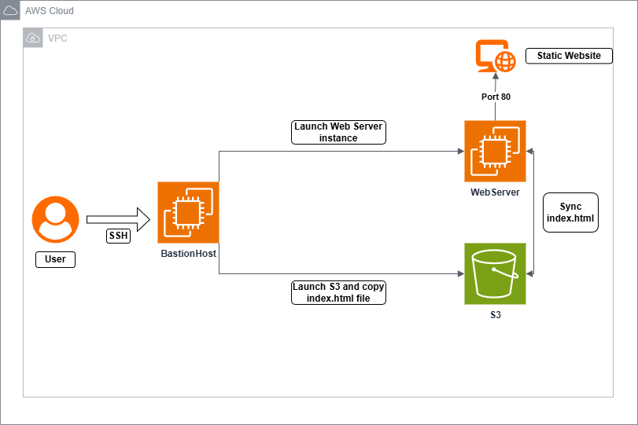
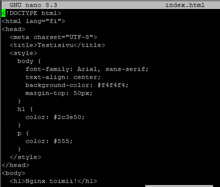
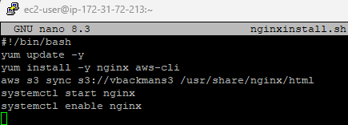
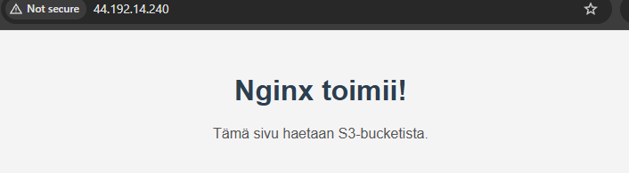
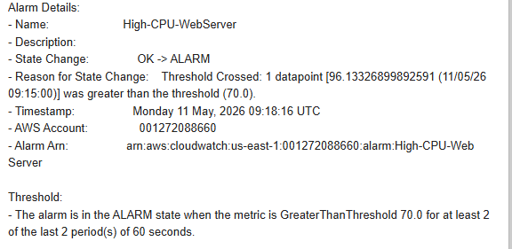
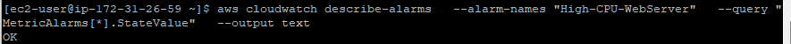

# AWS Static Website Hosting and Monitoring

In this project, I built a simple static website using AWS. I used two EC2 instances, an S3 bucket, Nginx and the AWS CLI. I also added CPU monitoring with CloudWatch and email notifications with Amazon SNS.

**Project:** AWS Learner Lab course project, May 2026  
**Status:** Completed learning project; the website is not currently running.

For the actual AWS CLI commands I used, see [**AWS CLI implementation notes**](docs/implementation.md). The commands are taken from my original report, with environment-specific values replaced by placeholders.

## Phase 1 — Hosting a static website

### 1. Planning the environment

I planned an environment with two EC2 instances and one S3 bucket:

- **Bastion Host:** I connected to this instance using SSH and used the AWS CLI to manage AWS resources.
- **S3 bucket:** I stored the website's `index.html` file here.
- **Web Server:** This instance ran Nginx and copied the HTML file from S3 into its web root.

I used the lab's default VPC and subnet. The bastion host allowed SSH traffic on port 22, while the web server allowed HTTP traffic on port 80.



*Figure 1. My original architecture diagram from the project report.*

### 2. Creating the bastion host

I used AWS CloudShell and the AWS CLI to find the VPC ID, create a security group and launch an Amazon Linux 2023 EC2 instance. I attached the lab's `LabInstanceProfile` IAM instance profile and connected to the bastion host using PuTTY and SSH.

For example, I used `aws ec2 run-instances` to launch the EC2 instances. The complete command, including the AMI, security group, SSH key and IAM profile options, is in the [implementation notes](docs/implementation.md).

### 3. Creating the HTML page and storing it in S3

I created an S3 bucket in `us-east-1`. On the bastion host, I used `nano` to write a simple `index.html` page and uploaded it to S3 using the AWS CLI. I also listed the bucket contents to check that the upload worked.

```bash
aws s3 cp index.html s3://<your-bucket-name>/
```

*Command from my original report; the bucket name has been replaced with a placeholder.*

The screenshot below shows **part of my original HTML code**. I no longer have the complete source file, so I am sharing the original screenshot rather than recreating the code.



*Figure 2. The HTML file I created for the test website.*

### 4. Setting up the Nginx web server

I created a second security group with inbound HTTP access on port 80. Then I wrote a user data script for the web server. It updated packages, installed Nginx and the AWS CLI, copied the HTML file from S3 into `/usr/share/nginx/html`, and started and enabled Nginx.



*Figure 3. The user data script used to configure the web server.*

I launched the web server EC2 instance with this script and the lab IAM instance profile. The website was served by **Nginx on EC2**; S3 was used to store the source file.

### 5. Testing the website

Finally, I opened the web server's public IP address in a browser. The page displayed the text **“Nginx toimii!”**, confirming that the web server was working and serving my HTML page.



*Figure 4. The website running in the browser.*

## Phase 2 — Monitoring and email alerts

### 6. Creating an SNS email subscription

I created an SNS topic named `cpu-alerts`, subscribed my email address and confirmed the subscription. This allowed CloudWatch to send an email when an alarm was triggered.

### 7. Configuring a CloudWatch alarm

I created the `High-CPU-WebServer` CloudWatch alarm to monitor the web server's `CPUUtilization` metric. I set the threshold to **above 70% for two consecutive 60-second periods** and connected the alarm to the SNS topic.

### 8. Testing the alarm

To test the alarm, I temporarily enabled SSH access to the web server and connected to it. I ran `yes > /dev/null &` twice to generate CPU load. The CloudWatch alarm changed to **ALARM**, and SNS sent an email notification.



*Figure 5. The SNS notification received after the CPU alarm was triggered.*

I then stopped the load with `killall yes`. After a few minutes, I checked the alarm again and confirmed that it had returned to **OK**.



*Figure 6. CloudWatch alarm returned to OK after the test.*

## What I learned

This project gave me practical experience with:

- Creating EC2 instances and security groups using the AWS CLI
- Connecting to Linux instances using SSH
- Storing and checking files in Amazon S3
- Automating web server setup with EC2 user data
- Hosting a static website with Nginx
- Monitoring CPU usage with CloudWatch and sending alerts with SNS
- Testing my setup and checking the results

## Security and future improvements

This was a **Learner Lab exercise**, not a production setup. During the lab, SSH was allowed from `0.0.0.0/0`, and the website used HTTP instead of HTTPS. For a real environment, I would restrict SSH access, use HTTPS, review IAM permissions and separate public and private network resources.

In my original report, I suggested a private subnet for the web server, a public load balancer and possible automatic scaling. These were **ideas for future improvements**, not features implemented in this project.

## More information

- [Implementation notes](docs/implementation.md)
- [Example Nginx user data script](scripts/nginxinstall.sh) — a sanitized example, not an exact copy of the original deployed script

The images above come from my original May 2026 project report. The original PDF is not published because it contains AWS credentials in one screenshot.
